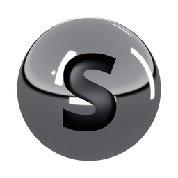

<p align="center"></p>

# Still

A quiet photo editor for Linux, Windows and macOS, written in Rust (egui).
Tone, colour, film texture and a few restrained glitches. No more than that.

## Download

Grab the latest build from **Releases**:

- **Linux:** `Still-x86_64.AppImage`. Run `chmod +x Still-x86_64.AppImage`, then run the file.
- **Windows:** `Still-windows-x64.exe`. The app isn't code-signed, so SmartScreen may ask: choose *More info → Run anyway*.
- **macOS** (Apple Silicon and Intel, macOS 11+): `Still-macos.dmg`. Open it and drag Still into Applications. The app isn't notarized, so the first launch is blocked: open *System Settings → Privacy & Security* and click *Open Anyway* (or run `xattr -dr com.apple.quarantine /Applications/Still.app`).

Releases are built by GitHub Actions (`.github/workflows/release.yml`) whenever a `v*` tag is pushed.

## Build from source

```sh
cargo run --release                 # open the app
cargo run --release -- photo.jpg    # open a photo directly
./install.sh                        # install to ~/.local/bin + app launcher
```

Headless batch rendering with a preset:

```sh
still --render "Overcast" in.RW2 out.tif
```

## What it does

- **Opens** JPEG, PNG, TIFF (8/16-bit), WebP, GIF, EXR, and camera RAW (RW2, CR2/CR3, NEF, ARW, DNG, RAF, ORF…). Drop a photo on the window, open it from the **Recent** list on the start screen, or paste one with Ctrl+V
- **Animations:** an animated GIF (or animated WebP / APNG) opens with every frame. It plays on the canvas; pause it, step frame by frame or scrub to any frame. The edit applies to every frame, and **Export → GIF** writes the whole animation back out, looping, with optional **New Seed Every Frame** so grain and glitches flicker like film. Any still picture can be exported as a GIF too
- **Pixel view:** zoom in on a picture's real pixels (a 32 × 32 sprite, a screenshot, pixel art) and each pixel is a sharp square, like in Paint, with a grid between them once they're big enough. Small pictures fill the canvas in whole steps, so every pixel is the same size
- **Presets:** fifteen built-in presets with live thumbnails (including Pathologic, Deus Ex, MGS4 and Half-Life 2 “City 17” game presets), plus your own saved presets
- **Adjust:** exposure, contrast, highlights/shadows, whites/blacks, fade, white balance, saturation/vibrance, B&W, split toning, sharpen/soften
- **Masks:** local adjustments through **Object** selections (click a subject and it grows to its edges, with a threshold; place + points to add to it and − points where it should not go, and click a point to delete it), linear gradients, radial (elliptical) masks, a brush with feather, flow and erase, and luminance or colour ranges. You can refine any shape by a luminance or colour range, picking the colour from the photo. Each mask has its own exposure, contrast, highlights, shadows, temperature, tint, saturation, sharpness and colour wash, plus invert, amount, a visibility toggle, a red overlay that stays up while you shape the mask and hides once you adjust. Double-click a mask to rename it; right-click → **Change Color** gives it a label colour, which its overlay then uses. **Make Transparent** cuts a mask's area out of the picture (select a subject, invert, and the background is gone, or put a layer **Behind Photo** to replace it); PNG, TIFF and WebP exports keep the transparency. Masks stay attached to the picture when you re-crop, and they render the same in the preview and the export
- **Projects:** **Save** (Ctrl+S) stores the photo and the whole edit (adjustments, crop, masks, retouching, layers, groups) in a `.still` file. Open it again later with **Open**, by dropping it on the window, or with `still edit.still`. If you move a folder that holds the project together with its photos, it still opens
- **Text:** **Add Text** in the Layers tab makes a text layer. Type in the text box (or double-click the text on the canvas), pick any font (the built-in one, the fonts installed on your computer, or your own .ttf / .otf with **Add Font…**, which Still keeps a copy of), set the weight, italic, alignment, letter spacing and line height, colour it with a fill or a gradient, add an outline and a drop shadow, and bend the line into an **Arc** or a **Wave**. A text layer is a layer like any other, so it moves, scales, stretches, turns, blends and bends with perspective and mesh too
- **Perspective and mesh:** **Transform → Handles** switches a layer's handles between **Transform** (move, scale, stretch, turn), **Perspective** (drag the four corners to lay the layer on a wall or a screen) and **Mesh** (drag the points of a grid, 1 to 8 cells each way, to bend it into any shape). The two combine; **Reset Bend** straightens the layer again
- **Layers:** place other photos on the canvas, PNG transparency included. Move, scale and rotate them directly on the photo (Shift snaps rotation). Side handles stretch a layer, and **Stretch** fills the whole canvas. Edges snap to the canvas sides and centre, and the **Magnet** pulls a layer flush against other layers as you move, scale, stretch or turn it, side by side or edges lined up, tilted layers included. **Auto Pivot** (optional) also turns the layer to match the one it snaps to, and scaling a layer that touches another keeps the touching side in place. Hold Ctrl to place freely. Arrow keys nudge a layer, and dragging layers in the list reorders them. Each layer has opacity, nine blend modes (Normal, Multiply, Screen, Overlay, Soft Light, Darken, Lighten, Difference, Add), flip, Fit/Fill, ordering and visibility. A layer either takes on the preset with the photo or sits on top of it, which suits light leaks and textures. Add layers with **Add Photo…**, by dropping photos on the window while a photo is open, or by pasting an image or copied image files with Ctrl+V. Masks only look at and cut your photo, never the layers, and **Behind Photo** puts a layer underneath the picture so it shows through whatever **Make Transparent** cut out (a new sky behind a subject, for example). Double-click a layer to rename it, or right-click → **Change Color** to label it. Right-click → **Lock** keeps a layer from being moved or changed, and **Group** puts layers in folders you can name, colour, collapse and hide together
- **Retouch:** a clone brush for painting out stray objects. Ctrl+click where to copy from, then paint; the source follows the brush at the same distance
- **Effects:** bloom, halation, astigmatism (lights smear into streaks, crosses or stars), chromatic aberration, vignette, film grain, CCD noise, scanlines, posterize with ordered dither, downsample (blocky or soft low resolution). **Apply To** limits them to one mask
- **Glitch:** pixel sort, data streaks, slice shift, RGB split, block compression. **Apply To** limits them to one mask
- **Seeds:** grain and every glitch are placed by a seed, so an arrangement you like can be reproduced. Each effect follows the **Main Seed** (Shuffle changes them all at once) until you give it its own: type any number, roll a **Random** one, or **Copy** a seed from one effect and **Paste** it into another (Copy also puts it on the clipboard). **Use Main** makes an effect follow the main seed again
- **Any value:** click the number on any slider to type a value, including far beyond the slider's ends (exposure +12, saturation 500, a 3000 % glow…). Typed values past the range show in blue
- **Crop:** drag the crop rectangle on the photo; Free, Original, Square, 5:4, 3:2, 4:3, 16:9, 2.39:1 and XPan presets in landscape or portrait; straighten (±45°), a horizon line you lay along the horizon (or any angle) and **Level Photo** to match, rotate, flip, border; a rule-of-thirds grid while cropping, and thirds or golden-ratio guides in every tab
- **Export:** JPEG (quality), PNG/TIFF at 8 or 16 bits, WebP lossless, GIF (animated or still, cut-outs transparent); resize by long edge or percent (Lanczos); output sharpening; keeps EXIF metadata and the embedded colour profile; 8-bit output is dithered so gradients don't band; writes atomically
- **Updates:** Still checks GitHub for a newer release when it starts and shows a notice with **Install**, **What's New**, **Skip** and **Later**. Turn on **Install Updates Automatically** in Settings and a new version downloads in the background (its SHA-256 checked against the release) and replaces the Windows .exe, the AppImage or the macOS app; it starts on the next launch. Builds from source get the notice and a link instead

Effect sizes scale with image resolution, so the preview matches the full-size export. Zoom in past the preview's resolution and Still renders a sharper preview once the zoom settles. While you drag a slider on a large photo, the preview drafts at half size and sharpens when you let go.

## Sharing presets

Right-click any preset and choose **Export…**, or use **Share Presets → Export My Presets…**, to save a `.stillpreset` file. Friends can **Import…** it, drop it onto the window, or open it with `still preset.stillpreset`. Only the preset is shared: never the photo, the crop, the masks or the retouching. Older `.stilllook` files still open. The command line accepts preset files too:

```sh
still --render friend.stillpreset in.jpg out.jpg
```

## Settings

**Settings** (Ctrl+,) covers:

- preview quality (1200 / 1800 / 2600 px)
- canvas colour
- mask overlay colour
- histogram mode
- render time
- Pixel View and Pixel Grid
- guides
- whether a new photo keeps the current preset
- update checks and automatic updates (with **Check Now**)
- Linux: native Wayland or XWayland (the default, needed for drag and drop)
- importing and exporting presets

## Keys

| | |
|---|---|
| Ctrl+O | Open |
| Ctrl+S / Ctrl+Shift+S | Save project / Save As |
| Ctrl+E | Export |
| Ctrl+V | Paste an image as a layer |
| Ctrl+, | Settings |
| Ctrl+Z / Ctrl+Shift+Z | Undo / Redo |
| `\` (hold) | Compare with the original |
| 1 to 8 | Switch sidebar tab |
| O (hold) | Show the selected mask as a red overlay |
| Alt + paint | Erase with the brush |
| Alt + click | Place the other kind of point (+ or −) in an Object selection |
| Ctrl + click | Choose the clone source (Retouch) |
| [ / ] | Brush size |
| Space + drag | Pan while a mask is selected |
| Delete | Delete the selected mask or layer |
| Arrow keys (+Shift) | Nudge the selected layer |
| Ctrl+0 / double-click | Fit / zoom |
| Double-click a slider | Reset it |
| Click a slider's number | Type any value |
| Double-click a text layer | Edit its text |
| Shift + drag a slider | Fine adjustment |

Settings, saved presets and the Recent list are stored in `~/.config/still/settings.json` (Windows: `%APPDATA%\Still\settings.json`).

The interface font is Adwaita Sans, bundled under the SIL Open Font License (`assets/fonts/OFL.txt`). It is also the built-in font for text layers; fonts added with **Add Font…** are kept in the `fonts` folder next to the settings.

The icon is rendered in Blender from `assets/icon-source/still_icon.py` (`blender -b -P assets/icon-source/still_icon.py -- out.png 1024 256`), then saved as `assets/icon.png`, `assets/icon-256.png` and the Windows `assets/icon.ico`, which `build.rs` puts into Still.exe.
